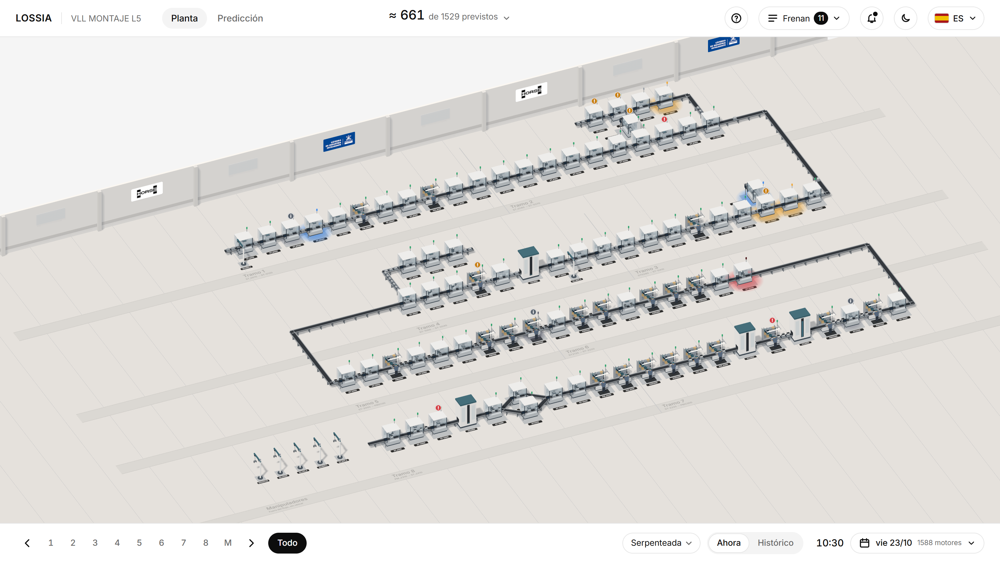

# Twinhorse

We built a 3D digital twin of an engine assembly line. For every machine and day, it tells you if the machine stopped by itself, if its neighbours stopped it, or if the data can't be trusted. The machine that stops the most is not the one that slows the line the most. Python, React and three.js.

By Rafael Maestre López, Adrián Ruiz Ibáñez, Carlos María Bermejo Pérez del Palomar and Rodrigo Lucio García. Hackathon XI, Cátedra de Industria Inteligente, ICAI, November 2026.

[Setup and use](docs/USAGE.md) · [Results and limits](docs/RESULTS.md)
