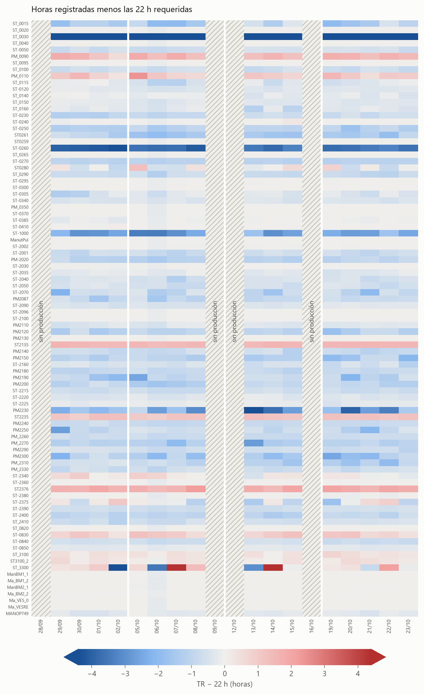
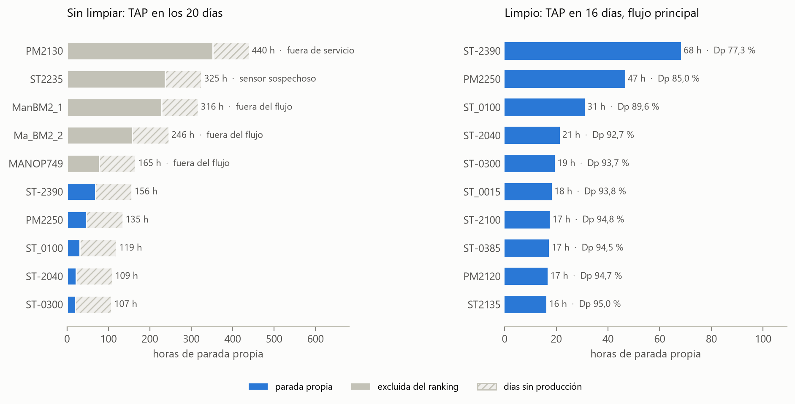
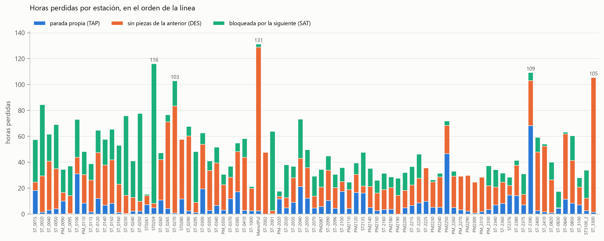
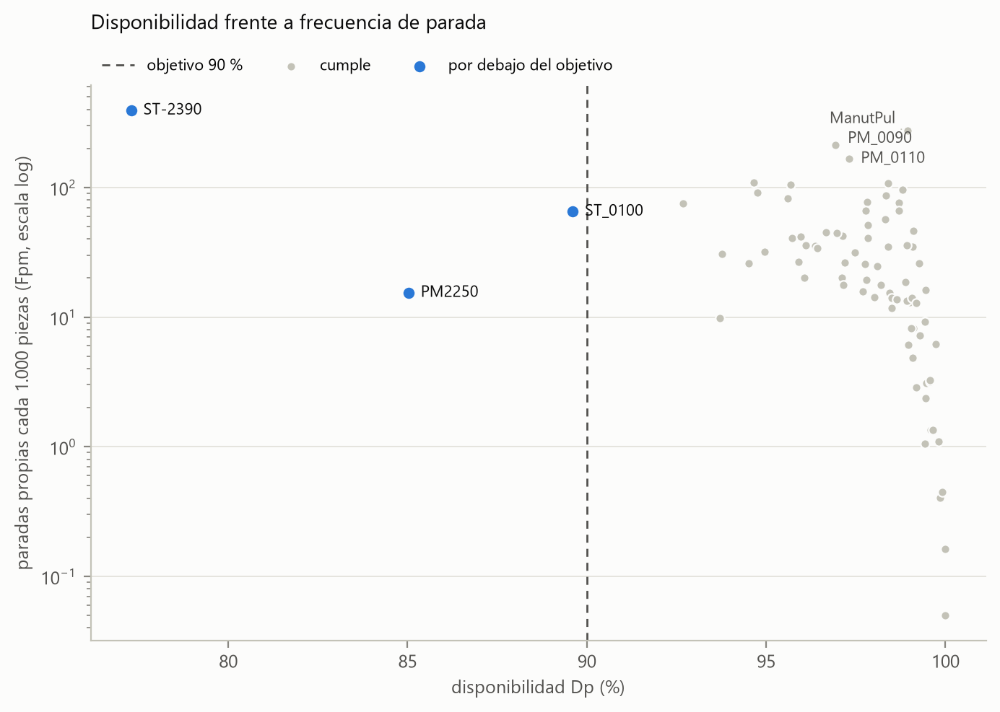
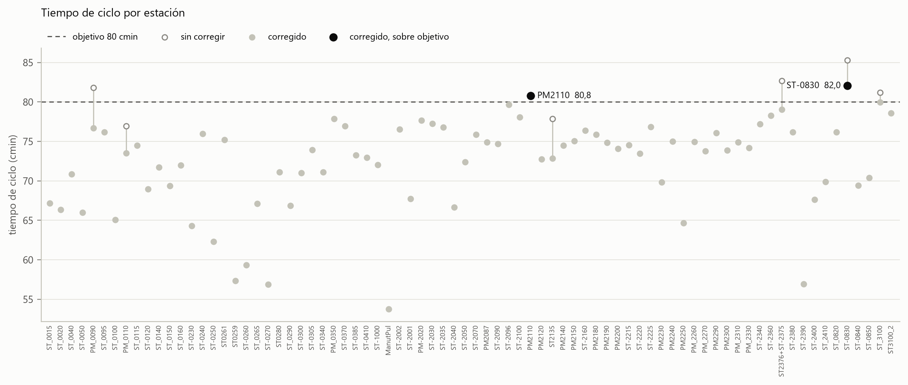
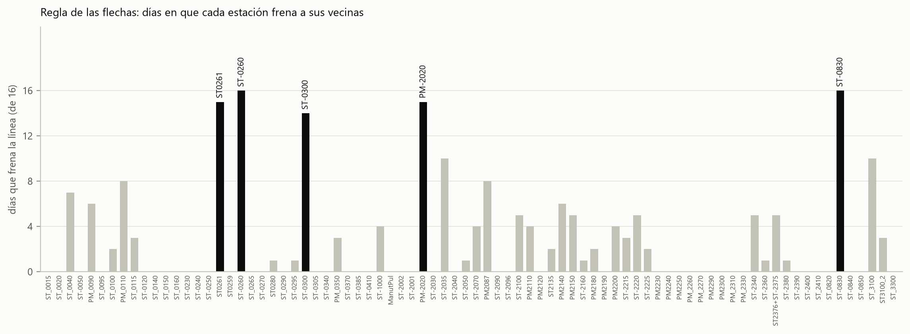

# EDA · VLL_MONTAJE_L5

Para regenerarlo: `python eda/run_eda.py --line VLL_MONTAJE_L5` desde la raíz del repo. Reglas en `backend/pipeline/clean.py`, KPIs en `backend/pipeline/kpis.py` y parámetros de la línea en `lines/VLL_MONTAJE_L5.json`.

## Los datos

- 1.820 filas: 91 operaciones por 20 días, del 28/09/2026 al 23/10/2026.
- Tiempo requerido por periodo: 22 h. Objetivos: Dp ≥ 90 % y Tcy ≤ 80 cmin.
- La línea hace unas 1.521 piezas por periodo (mediana de NPR por estación).
- Estaciones fuera del flujo principal: MANOP749, Ma_BM1_2, Ma_BM2_2, Ma_VESRE, Ma_VES_0, ManBM1_1 y ManBM2_1.
- Grupos en paralelo (detectados en los datos): ST2376+ST-2375.

## 1. Calidad del dato

Ninguna regla borra filas. Cada una pone un flag y el análisis decide qué hacer con él.

| Regla | Qué pasa | Filas | Dónde (días) | Decisión |
| --- | --- | --- | --- | --- |
| no_productivo | Periodo sin producción: la mediana de TBF de la línea es 0 y no cuenta piezas | 364 | 2026-09-28, 2026-10-09, 2026-10-12, 2026-10-16 | Excluir el periodo |
| sin_datos | La estación no registra nada (TR = 0) | 16 | ST_0030 (16) | Excluir la fila |
| fuera_servicio | TBF = 0 y TAP ocupa casi todo el periodo | 22 | PM2130 (16), Ma_BM2_2 (4), ManBM2_1 (2) | Excluir: fuera de servicio o by-pass |
| tr_mayor | TBF + TAP + DES + SAT supera las 22 h requeridas | 161 | PM_0090 (16), PM_0110 (16), ST2135 (16), ST2235 (16), ST2376 (16), ST-0830 (16) y 9 mas | Reescalar las cuatro horas a 22 h |
| tr_menor | TBF + TAP + DES + SAT no llega a 19,8 h | 47 | ST-0260 (16), ST-1000 (13), PM2230 (9), ST_3300 (3), PM2300 (2), ST-2070 (1) y 3 mas | Mantener y marcar: falta tiempo sin explicar |
| sensor_sospechoso | Más paradas propias que piezas (NAP > NPR) con un contador creíble | 16 | ST2235 (16) | Excluir del ranking: falsa alarma candidata |
| contador_doble | NPR mayor que 1,3 veces la mediana de la línea | 32 | ST2235 (16), ST_3300 (16) | Usar el NPR de la línea |
| contador_roto | Trabaja pero cuenta menos de 0,3 veces las piezas de la línea | 75 | ST-0295 (16), Ma_BM1_2 (16), Ma_VES_0 (16), Ma_VESRE (16), ManBM2_1 (10), MANOP749 (1) | Usar el NPR de la línea |

Azul: faltan horas. Rojo: sobran. Gris rayado: periodo sin producción.

- Quedan 16 días con producción (sin producción: 28/09, 09/10, 12/10, 16/10).
- Fuera del ranking: PM2130 (fuera de servicio), ST2235 (sensor sospechoso) y ST_0030 (sin datos).

## 2. La que más se para no es la que penaliza

Sin limpiar, el top 5 por parada propia es PM2130 (fuera de servicio), ST2235 (sensor sospechoso), ManBM2_1 (fuera del flujo), Ma_BM2_2 (fuera del flujo) y MANOP749 (fuera del flujo). Ninguna cuenta en el ranking limpio. Además, cada estación suma el TAP de los 4 días sin producción.

Tras limpiar, el top 5 del flujo principal es este:

| Estación | TAP (h) | Dp (%) | Fpm | Segundos por parada |
| --- | --- | --- | --- | --- |
| ST-2390 | 68,3 | 77,3 | 393 | 26 |
| PM2250 | 46,6 | 85,0 | 15 | 443 |
| ST_0100 | 31,1 | 89,6 | 65 | 69 |
| ST-2040 | 21,3 | 92,7 | 76 | 42 |
| ST-0300 | 19,4 | 93,7 | 10 | 290 |

ST-2390 hace microparadas de unos 26 s. PM2250 hace paradas largas de unos 7 min.

## 3. Dónde se pierde el tiempo

En el flujo principal se pierden 643 h por parada propia y 3.282 h por parada inducida. Las que más horas inducidas acumulan son ManutPul (127 h sin piezas), ST0259 (108 h bloqueada) y ST_3300 (104 h sin piezas).

## 4. Disponibilidad

Por debajo del 90 %: ST-2390 (77,3 %), PM2250 (85,0 %) y ST_0100 (89,6 %).

## 5. Tiempo de ciclo

Con las horas corregidas, superan los 80 cmin: PM2110 (80,8) y ST-0830 (82,0).
Sin corregir también saldría PM_0090 (81,8), ST2376+ST-2375 (82,7) y ST_3100 (81,2), pero es efecto de registrar más de 22 h.
ST2376+ST-2375 se cuenta como una sola estación.
Sin Tcy porque su contador de piezas no es fiable: ST-0295 y ST_3300.

## 6. Quién frena la línea (primera mirada)

Regla de las flechas (Kuo, Lim y Meerkov): una estación frena la línea en un periodo si la anterior está más bloqueada que ella sin piezas (SAT anterior > DES propia) y la siguiente está más sin piezas que ella bloqueada (DES siguiente > SAT propia). Se calcula periodo a periodo saltando las estaciones no fiables.

Cumplen la regla en 12 días o más: ST-0260 (16), ST-0830 (16), ST0261 (15), PM-2020 (15) y ST-0300 (14).
Coinciden con el top 5 de parada propia: ST-0300.
Ojo con ST-0260: registra menos de 19,8 h en la mayoría de periodos. Hay que confirmar sus datos antes de señalarla.

## Supuestos

- El orden de la línea es Orden_OP de la configuración.
- Contador doble: NPR por encima de 1,3 veces la mediana de la línea. Contador roto: por debajo de 0,3 veces trabajando.
- Periodo corto: menos de 19,8 h registradas. Una estación sale del ranking si falla en el 50 % de sus periodos.
- Paralelo: estaciones a menos de 4 puestos que juntas hacen entre 0,85 y 1,15 veces las piezas de la línea.

## Ficheros

- `data/processed/VLL_MONTAJE_L5/clean.csv`: todas las filas con sus flags y las horas limpias (`tbf_h`, `tap_h`, `des_h`, `sat_h`, `npr_ef`).
- `data/processed/VLL_MONTAJE_L5/data_quality.csv`: la tabla de calidad de la sección 1.
- `data/processed/VLL_MONTAJE_L5/station_kpis.csv`: KPIs acumulados por estación.
- `data/processed/VLL_MONTAJE_L5/cycle_times.csv`: Tcy por estación, con los grupos en paralelo juntos.
