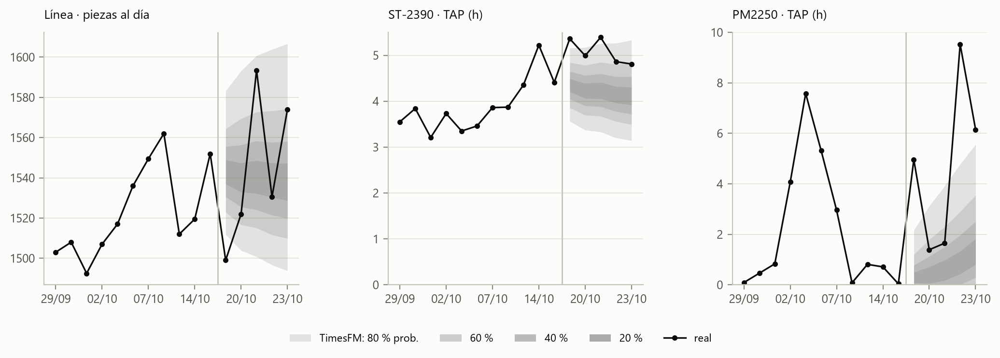

# Backtest · VLL_MONTAJE_L5

Para regenerarlo: `python forecast/run_forecast.py backtest --line VLL_MONTAJE_L5`.

- Contexto: 11 días con producción, del 29/09 al 15/10. Prueba: 5 días, del 19/10 al 23/10.
- Series: TAP, DES y SAT de 81 estaciones del flujo principal, y las piezas al día de la línea.
- Modelos: último valor, media, TimesFM, TimesFM + calendario, TimesFM + calendario + vecinas. Covariables de calendario: día de la semana, primer día tras una parada y víspera de parada. Vecinas: el TAP de la estación anterior para predecir DES y el de la siguiente para SAT.

## Qué gana

- **A un día vista gana** en DES (h) la media (0,30 de error); en piezas al día la media (30 de error); en SAT (h) la media (0,26 de error); en TAP (h) TimesFM (0,21, un 12 % menos que la media).
- **A la semana gana** en DES (h) la media (0,32 de error); en piezas al día TimesFM + calendario (26, un 15 % menos que la media); en SAT (h) la media (0,27 de error); en TAP (h) la media (0,25 de error).
- **Banda mejor calibrada:** TimesFM. El 80 % de los días reales cae dentro de su p10–p90 (lo ideal es el 80 %). Con la media cae el 70 %.
- **TimesFM + calendario tiene la banda demasiado estrecha:** solo el 53 % de los días cae dentro. Con tan poca historia, las covariables estrechan la banda sin mejorar la predicción.

Las paradas largas pesan mucho en el error: los 4 estación-días de la semana de prueba con paradas de más de 5 min de media se llevan el 15 % del error de TAP. Son eventos sueltos (posibles intervenciones planificadas) que ningún modelo puede anticipar con datos diarios. Están en `paradas_largas.csv`.

En la figura, TimesFM predice la semana de prueba de golpe: la línea, y las dos estaciones con más parada propia.

## Semana completa: 5 días de golpe

| Métrica | Modelo | Error medio | Frente a la mejor referencia | Dentro de p10–p90 | Series en que gana |
| --- | --- | --- | --- | --- | --- |
| DES (h) | último valor | 0,44 |  | 74 % |  |
| DES (h) | media | 0,32 |  | 71 % |  |
| DES (h) | TimesFM | 0,35 | -10 % | 82 % | 33 % |
| DES (h) | TimesFM + calendario | 0,39 | -24 % | 45 % | 14 % |
| DES (h) | TimesFM + calendario + vecinas | 0,39 | -22 % | 66 % | 23 % |
| piezas al día | último valor | 34 |  | 40 % |  |
| piezas al día | media | 31 |  | 40 % |  |
| piezas al día | TimesFM | 32 | -4 % | 80 % | 0 % |
| piezas al día | TimesFM + calendario | 26 | +15 % | 80 % | 100 % |
| piezas al día | TimesFM + calendario + vecinas | 29 | +5 % | 60 % | 100 % |
| SAT (h) | último valor | 0,31 |  | 78 % |  |
| SAT (h) | media | 0,27 |  | 69 % |  |
| SAT (h) | TimesFM | 0,29 | -10 % | 79 % | 16 % |
| SAT (h) | TimesFM + calendario | 0,31 | -17 % | 43 % | 22 % |
| SAT (h) | TimesFM + calendario + vecinas | 0,31 | -16 % | 60 % | 26 % |
| TAP (h) | último valor | 0,37 |  | 77 % |  |
| TAP (h) | media | 0,25 |  | 67 % |  |
| TAP (h) | TimesFM | 0,26 | -4 % | 80 % | 23 % |
| TAP (h) | TimesFM + calendario | 0,26 | -6 % | 39 % | 23 % |
| TAP (h) | TimesFM + calendario + vecinas | 0,28 | -12 % | 39 % | 20 % |

## A un día vista

| Métrica | Modelo | Error medio | Frente a la mejor referencia | Dentro de p10–p90 | Series en que gana |
| --- | --- | --- | --- | --- | --- |
| DES (h) | último valor | 0,37 |  | 70 % |  |
| DES (h) | media | 0,30 |  | 74 % |  |
| DES (h) | TimesFM | 0,30 | 0 % | 81 % | 37 % |
| DES (h) | TimesFM + calendario | 0,32 | -8 % | 68 % | 26 % |
| DES (h) | TimesFM + calendario + vecinas | 0,31 | -3 % | 73 % | 30 % |
| piezas al día | último valor | 51 |  | 0 % |  |
| piezas al día | media | 30 |  | 40 % |  |
| piezas al día | TimesFM | 39 | -31 % | 40 % | 0 % |
| piezas al día | TimesFM + calendario | 30 | -3 % | 40 % | 0 % |
| piezas al día | TimesFM + calendario + vecinas | 32 | -7 % | 40 % | 0 % |
| SAT (h) | último valor | 0,32 |  | 71 % |  |
| SAT (h) | media | 0,26 |  | 71 % |  |
| SAT (h) | TimesFM | 0,26 | 0 % | 78 % | 32 % |
| SAT (h) | TimesFM + calendario | 0,26 | -2 % | 64 % | 30 % |
| SAT (h) | TimesFM + calendario + vecinas | 0,26 | 0 % | 69 % | 30 % |
| TAP (h) | último valor | 0,27 |  | 72 % |  |
| TAP (h) | media | 0,24 |  | 70 % |  |
| TAP (h) | TimesFM | 0,21 | +12 % | 80 % | 41 % |
| TAP (h) | TimesFM + calendario | 0,21 | +10 % | 62 % | 33 % |
| TAP (h) | TimesFM + calendario + vecinas | 0,21 | +12 % | 68 % | 36 % |

Error medio: en horas para TAP, DES y SAT, en piezas para la línea. Lo ideal en «Dentro de p10–p90» es un 80 %.
«Series en que gana»: estaciones en que el modelo falla menos que las dos referencias.

## Ficheros

- `backtest_predicciones.csv`: cada predicción con sus deciles (p10 a p90) y el valor real.
- `backtest_metricas.csv`: la tabla de arriba.
- `paradas_largas.csv`: estación-días con paradas largas.
