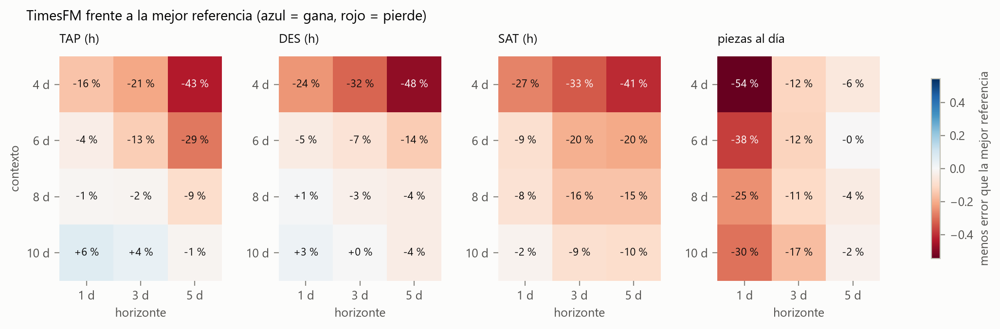
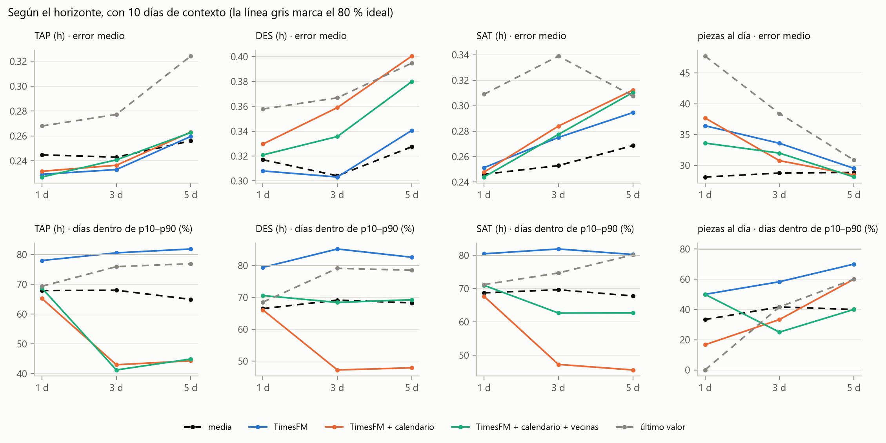

# Benchmark de la predicción · VLL_MONTAJE_L5

Para regenerarlo: `python forecast/benchmark.py --line VLL_MONTAJE_L5`.

- **Rejilla:** contexto 4, 6, 8, 10 días × horizonte 1, 3, 5 días, con origen rodante.
- **Mismos días objetivo para todas las configuraciones:** 6 días productivos, del 15/10 al 23/10. Así la diferencia entre celdas solo se debe a la ventana.
- **Series:** TAP, DES y SAT de 81 estaciones y las piezas al día de la línea. 136.640 predicciones en total.
- **Modelos:** último valor, media, TimesFM, TimesFM + calendario, TimesFM + calendario + vecinas.
- **Mejora** = cuánto menos falla que la mejor de las dos referencias (último valor y media) en esa misma celda. Una mejora por debajo del 1 % cuenta como empate.

## Conclusión

- **Más contexto ayuda a TimesFM:** en TAP a 1 día pasa de -16 % con 4 días de historia a +6 % con 10. Con los 16 días que tenemos, no llega a separarse de forma clara.
- **Para el valor central gana la media** en 28 de 36 celdas de estación. Predecir el número exacto de horas de mañana con dos semanas de historia no mejora a «lo de siempre».
- **Para la banda gana TimesFM:** el 78 % de los días reales cae dentro de su p10–p90 (ideal 80 %), frente al 61 % de la media y el 67 % del último valor. Las covariables estrechan demasiado la banda. Por eso usamos TimesFM sin covariables como **banda de normalidad para detectar anomalías**, no como pronóstico.

## Resultado

| Modelo | Celdas en que gana | Mejora media (estaciones) | Cobertura p10–p90 (estaciones) |
| --- | --- | --- | --- |
| último valor |  |  | 67 % |
| media |  |  | 61 % |
| TimesFM | 3 de 48 | -13,2 % | 78 % |
| TimesFM + calendario | 9 de 48 | -14,1 % | 54 % |
| TimesFM + calendario + vecinas | 8 de 48 | -11,8 % | 62 % |

Las cinco celdas donde TimesFM más gana:

| Métrica | Modelo | Contexto | Horizonte | Mejora |
| --- | --- | --- | --- | --- |
| piezas al día | TimesFM + calendario + vecinas | 6 d | 3 d | 26 % |
| piezas al día | TimesFM + calendario | 6 d | 3 d | 25 % |
| piezas al día | TimesFM + calendario | 6 d | 5 d | 23 % |
| piezas al día | TimesFM + calendario + vecinas | 6 d | 5 d | 21 % |
| piezas al día | TimesFM + calendario + vecinas | 4 d | 3 d | 16 % |

**Estabilidad:** en TAP a un día vista con 10 días de contexto, la mejora de TimesFM día a día va del -30 % al 24 % (6 días). Con tan pocos días objetivo, diferencias de pocos puntos entre celdas no son significativas.

Las tablas completas están en `benchmark_metricas.csv` y las predicciones en `benchmark_predicciones.csv`.
