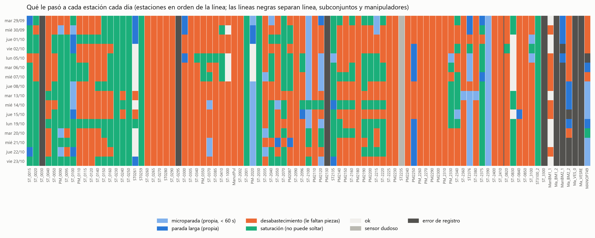
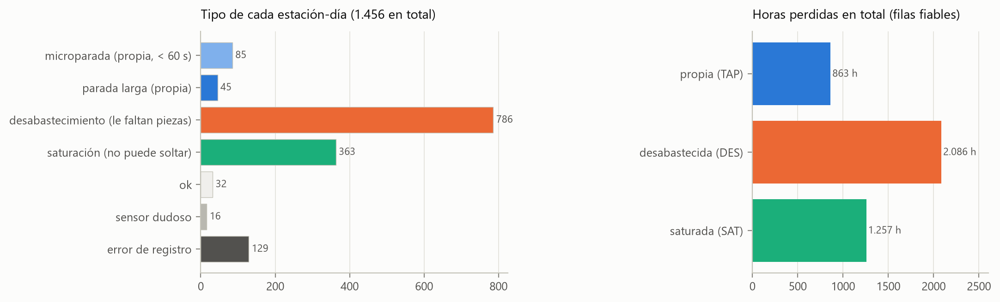
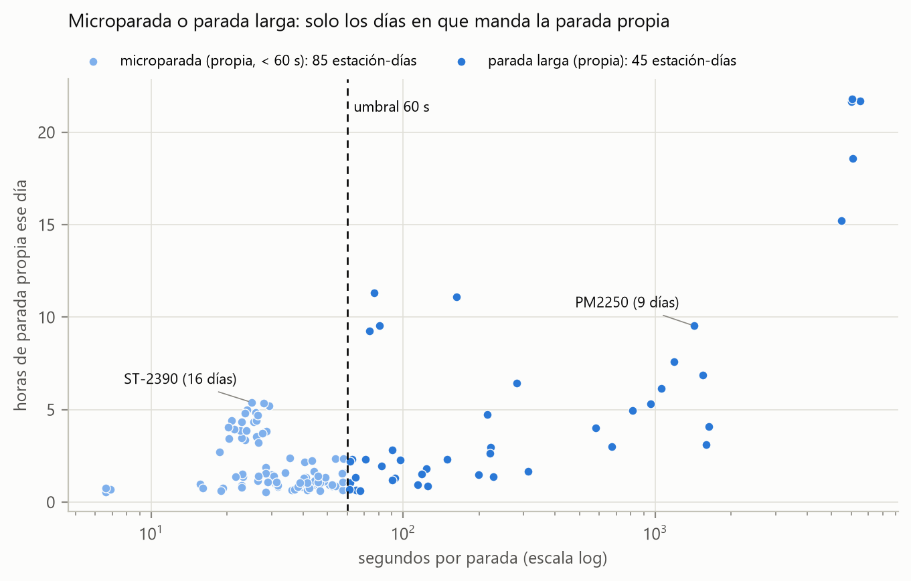
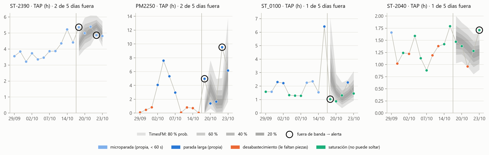

# Clasificación de paradas · VLL_MONTAJE_L5

Para regenerarlo: `python stops/classify.py --line VLL_MONTAJE_L5` y `python stops/plots.py --line VLL_MONTAJE_L5`.

Cada estación-día productivo (1.456) recibe un tipo por reglas fijas, sin modelo. En 1.149 manda una parada inducida por las vecinas y en 130 la parada propia. 145 no se clasifican porque el dato no es fiable.

Reglas, en orden (la primera que se cumple decide): error de registro (sin datos o fuera de servicio) → sensor dudoso (NAP > NPR) → error de registro (contador roto o doble) → si se pierde al menos 1 h, la mayor de SAT, DES o TAP (TAP con menos de 60 s por parada es microparada) → ok.

Lo inducido pesa más que lo propio: la mayoría de estaciones pasa casi todos sus días sin piezas o bloqueada. Estaciones donde manda la parada propia: MANOP749, PM-2020, PM2250, ST-2100, ST-2390, ST2376.

## Paradas fuera de la banda de normalidad

Con la banda de TimesFM a un día vista, 82 de 405 estación-días de la semana de prueba (20 %) tienen un TAP fuera de p10–p90. Por tipo: desabastecimiento (le faltan piezas) 47, saturación (no puede soltar) 21, parada larga (propia) 6, microparada (propia, < 60 s) 6, error de registro 2. Es la base de los avisos por banda del gemelo 3D (`frontend/scripts/build_mock.py`).

